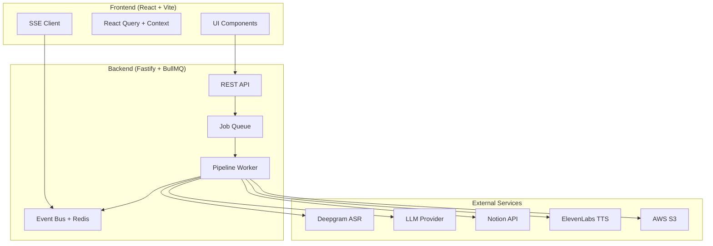

# ESL Pipeline – End-Goal Frontend Design Vision

> **Purpose:** This document visualizes the **fully realized** frontend as if all backend functionality is complete. It describes the end-user experience for teachers/tutors using the system to transform lesson recordings into polished, published homework assignments.

## 0. Scope, Priorities, and Assumptions

This vision is the **end-goal experience**. To keep delivery practical, the scope is organized into
must-haves (core workflow) and nice-to-haves (enhancements once the core is solid).

### Must-have (core workflow)

- Dashboard with quick actions, activity stream, and pending approvals.
- Wizard flow: select student → upload → transcript review → notes → draft review → publish.
- Draft editor with split preview + validation feedback.
- Job monitoring view with clear status and common actions.
- Student management basics (CRUD + timeline).
- Settings for job defaults and integration keys.

### Nice-to-have (post-core)

- Rich transcript UI (timestamps, speaker labels, inline metadata).
- Job stage visualization, queue position, and ETA.
- Student notification delivery and delivery status.
- Advanced analytics and usage dashboards.
- Collaboration features and template libraries.

### Backend assumptions (must exist for the full vision)

- LLM draft generation endpoint(s) and prompt package storage.
- Transcript status signals that distinguish “processing” vs “missing.”
- Job progress detail (per-stage status/ETA) and queue metadata.
- Student notification pipeline and delivery state.
- Billing/usage signal for TTS cost estimates.

---

## 1. The Complete User Journey

```mermaid
flowchart LR
    subgraph Recording["📹 Recording Phase"]
        A[Record Lesson] --> B[Audio Files per Student]
    end

    subgraph Transcription["🎙️ Transcription Phase"]
        B --> C[Upload Audio]
        C --> D[Auto-Transcribe with Deepgram]
        D --> E[Review Transcript]
    end

    subgraph Generation["🤖 Generation Phase"]
        E --> F[Auto-Assemble Prompt Package]
        F --> G[Generate Homework via LLM]
        G --> H[Review & Edit Draft]
    end

    subgraph Publication["📤 Publication Phase"]
        H --> I[Approve Homework]
        I --> J[Generate TTS Audio]
        J --> K[Publish to Notion]
        K --> L[Notify Student]
    end
```



### The Tutor's "Happy Path"

1. **Login** → Tutor authenticates and sees their personalized dashboard
2. **Select Student** → Choose from student roster with recent activity visible
3. **Upload Recording** → Drag-and-drop the lesson's Opus audio file(s)
4. **Review Transcript** → See the auto-generated transcript, make minor corrections
5. **Add Notes** → Type optional lesson notes (e.g., "Focused on modal verbs today")
6. **Generate Homework** → One-click generates the homework draft via LLM
7. **Edit & Approve** → Rich markdown editor for final touches
8. **Publish** → TTS generation, S3 upload, and Notion publishing happen automatically
9. **Done** → Receive a shareable Notion link; student is notified

---

## 2. Core Application Views

### 2.1 Dashboard (Home)

The landing page after login. A command center for the tutor's workflow.

```
┌─────────────────────────────────────────────────────────────────────────────┐
│ ┌─────────────────────────────────────────────────────────────────────────┐ │
│ │ 🏠 ESL Pipeline                    [Search...]    🔔 3    👤 Tutor Name │ │
│ └─────────────────────────────────────────────────────────────────────────┘ │
├─────────────────────────────────────────────────────────────────────────────┤
│                                                                             │
│  ┌─── Quick Actions ────────────────────────────────────────────────────┐   │
│  │                                                                       │  │
│  │  ┌────────────┐  ┌────────────┐  ┌────────────┐  ┌────────────┐      │  │
│  │  │   📤 New   │  │ 📋 Recent  │  │ 👥 Students │  │ ⚙️ Settings │      │  │
│  │  │   Upload   │  │   Jobs     │  │   Roster   │  │            │      │  │
│  │  └────────────┘  └────────────┘  └────────────┘  └────────────┘      │  │
│  └───────────────────────────────────────────────────────────────────────┘   │
│                                                                             │
│  ┌─── Activity Stream ─────────────────┐  ┌─── Pending Approvals ─────────┐ │
│  │                                     │  │                               │ │
│  │  ✅ Irina's homework published      │  │  🕐 Tolik - Nov 28 lesson     │ │
│  │     2 minutes ago                   │  │     Draft ready for review    │ │
│  │                                     │  │                               │ │
│  │  🎙️ Sergei's audio transcribed     │  │  🕐 Maria - Nov 27 lesson     │ │
│  │     15 minutes ago                  │  │     Awaiting transcript edit  │ │
│  │                                     │  │                               │ │
│  │  📤 Maria's lesson uploaded         │  │                               │ │
│  │     1 hour ago                      │  │  [View All Pending →]         │ │
│  └─────────────────────────────────────┘  └───────────────────────────────┘ │
│                                                                             │
│  ┌─── This Week ────────────────────────────────────────────────────────┐   │
│  │                                                                       │  │
│  │  📊  Jobs: 12 completed │ 3 pending │ TTS Minutes: 47 used           │  │
│  │                                                                       │  │
│  │  Student    Last Lesson    Next Due     Status                        │  │
│  │  ──────────────────────────────────────────────────────────────────   │  │
│  │  👩 Irina   Nov 28        Dec 2         ✅ Published                  │  │
│  │  👨 Tolik   Nov 28        Dec 1         🕐 Pending approval           │  │
│  │  👩 Maria   Nov 27        Nov 30        ⏳ Transcript review          │  │
│  │  👨 Sergei  Nov 26        Nov 29        ✅ Published                  │  │
│  │                                                                       │  │
│  └───────────────────────────────────────────────────────────────────────┘   │
└─────────────────────────────────────────────────────────────────────────────┘
```

**Key Features:**

- **Quick Actions** for the most common workflows
- **Activity Stream** showing real-time updates via SSE
- **Pending Approvals** highlighting items needing attention
- **Weekly Summary** with usage stats and student overview

---

### 2.2 New Assignment Flow

A guided, wizard-style multi-step process for creating homework.

#### Step 1: Select Student & Upload Audio

```
┌─────────────────────────────────────────────────────────────────────────────┐
│ 📤 New Assignment                                     Step 1 of 5 ━━○○○○   │
├─────────────────────────────────────────────────────────────────────────────┤
│                                                                             │
│  ┌─── Select Student ───────────────────────────────────────────────────┐   │
│  │                                                                       │  │
│  │  [🔍 Search students...]                                              │  │
│  │                                                                       │  │
│  │  ┌──────────┐  ┌──────────┐  ┌──────────┐  ┌──────────┐              │  │
│  │  │  👩 Irina│  │ 👨 Tolik │  │ 👩 Maria │  │ 👨 Sergei│              │  │
│  │  │   B1     │  │   A2     │  │   B2     │  │   A1     │              │  │
│  │  │  ✓ 12 hw │  │  ✓ 8 hw  │  │  ✓ 15 hw │  │  ✓ 5 hw  │              │  │
│  │  └─── ✔️ ────┘  └──────────┘  └──────────┘  └──────────┘              │  │
│  │                                                                       │  │
│  └───────────────────────────────────────────────────────────────────────┘   │
│                                                                             │
│  ┌─── Upload Lesson Recording ──────────────────────────────────────────┐   │
│  │                                                                       │  │
│  │                    ┌─────────────────────────────┐                    │  │
│  │                    │                             │                    │  │
│  │                    │   📁 Drag & drop audio      │                    │  │
│  │                    │      or click to browse     │                    │  │
│  │                    │                             │                    │  │
│  │                    │   Accepts: .opus, .mp3,     │                    │  │
│  │                    │   .wav, .m4a                │                    │  │
│  │                    └─────────────────────────────┘                    │  │
│  │                                                                       │  │
│  │  ━━━━━━━━━━━━━━━━━━━━━━━━━━━━━━━━━━━━━━━━━━━━━━━━━━ 0%                │  │
│  │                                                                       │  │
│  └───────────────────────────────────────────────────────────────────────┘   │
│                                                                             │
│                                            [Cancel]   [Continue →]          │
└─────────────────────────────────────────────────────────────────────────────┘
```

#### Step 2: Review Transcript

```
┌─────────────────────────────────────────────────────────────────────────────┐
│ 📤 New Assignment                                     Step 2 of 5 ━━━○○○   │
├─────────────────────────────────────────────────────────────────────────────┤
│                                                                             │
│  ┌─── Transcript Review ────────────────────────────────────────────────┐   │
│  │                                                                       │  │
│  │  📄 2024-11-28_Irina_lesson.opus  │  ⏱️ 47:23  │  ✅ Transcribed     │  │
│  │                                                                       │  │
│  │  ┌─────────────────────────────────────────────────────────────────┐ │  │
│  │  │                                                                 │ │  │
│  │  │ [00:00] Teacher: Okay, so let's start. How was your week?       │ │  │
│  │  │                                                                 │ │  │
│  │  │ [00:05] Irina: It was good. My husband wake up early every      │ │  │
│  │  │ day this week because of work.                                  │ │  │
│  │  │                                                                 │ │  │
│  │  │ [00:12] Teacher: He "woke up" - past tense. But wait, you're    │ │  │
│  │  │ talking about a routine? Let me hear more...                    │ │  │
│  │  │                                                                 │ │  │
│  │  │ [00:18] Irina: Yes, he always wake up at 6 AM. He is            │ │  │
│  │  │ programmer and the company want him to work early.              │ │  │
│  │  │                                                                 │ │  │
│  │  │ [00:28] Teacher: Ah, I see. So his company "wants" him -        │ │  │
│  │  │ remember the third person 's'. And he "wakes up". Good!         │ │  │
│  │  │                                                                 │ │  │
│  │  └─────────────────────────────────────────────────────────────────┘ │  │
│  │                                                                       │  │
│  │  💡 Tip: Review for transcription errors. Minor grammar mistakes    │  │
│  │     in the student's speech are expected and helpful for the LLM.   │  │
│  │                                                                       │  │
│  └───────────────────────────────────────────────────────────────────────┘   │
│                                                                             │
│                                  [← Back]   [Skip]   [Approve & Continue →]  │
└─────────────────────────────────────────────────────────────────────────────┘
```

**End-goal expectations**

- Timestamped, speaker-labeled transcript with basic metadata (duration, model, status).
- Inline edits with quick-save.
- Clear indicator when transcript is still processing vs truly missing.

#### Step 3: Add Lesson Notes

```
┌─────────────────────────────────────────────────────────────────────────────┐
│ 📤 New Assignment                                     Step 3 of 5 ━━━━○○   │
├─────────────────────────────────────────────────────────────────────────────┤
│                                                                             │
│  ┌─── Lesson Notes ─────────────────────────────────────────────────────┐   │
│  │                                                                       │  │
│  │  ┌─────────────────────────────────────────────────────────────────┐ │  │
│  │  │ [NOTES]                                                         │ │  │
│  │  │                                                                 │ │  │
│  │  │ * Input Type: generate                                          │ │  │
│  │  │ * Other Notes: Focused on Present Simple 3rd person -s today.   │ │  │
│  │  │   Irina still struggles with "he wants" vs "he want".           │ │  │
│  │  │   Also introduced "want to + verb" patterns.                    │ │  │
│  │  │   She talked a lot about her husband's daily routine -          │ │  │
│  │  │   use this context for homework.                                │ │  │
│  │  │                                                                 │ │  │
│  │  └─────────────────────────────────────────────────────────────────┘ │  │
│  │                                                                       │  │
│  │  ⚡ Quick add:   [3rd person -s]  [want to/need to]  [daily routine] │  │
│  │                                                                       │  │
│  └───────────────────────────────────────────────────────────────────────┘   │
│                                                                             │
│  ┌─── Student Profile (read-only) ──────────────────────────────────────┐   │
│  │                                                                       │  │
│  │  👩 Irina | Level: A2 (Pre-Intermediate) | Lessons: 12               │  │
│  │                                                                       │  │
│  │  🎯 Goal: Visit son in Amsterdam with conversational fluency         │  │
│  │  ⚠️ Focus: Present Simple 3rd person -s (persistent error)           │  │
│  │  💪 Strengths: Strong motivation, analytical mindset                 │  │
│  │                                                                       │  │
│  │  [View Full Profile →]                                               │  │
│  └───────────────────────────────────────────────────────────────────────┘   │
│                                                                             │
│                                     [← Back]   [Generate Homework →]        │
└─────────────────────────────────────────────────────────────────────────────┘
```

**End-goal expectations**

- Quick-add chips for common notes.
- Read-only student snapshot (goal, focus areas, recent activity).

#### Step 4: Review & Edit Generated Homework

````
┌─────────────────────────────────────────────────────────────────────────────┐
│ 📤 New Assignment                                     Step 4 of 5 ━━━━━○   │
├─────────────────────────────────────────────────────────────────────────────┤
│                                                                             │
│  ┌─── Homework Preview ─────────────────────────────────────────────────┐   │
│  │                                                                       │  │
│  │  Split View:   [Editor]  [Preview]  [Split ✓]                        │  │
│  │                                                                       │  │
│  │  ┌──────────────────────────┬──────────────────────────────────────┐ │  │
│  │  │ ```markdown              │                                      │ │  │
│  │  │ ---                      │  ──────────────────────────────────  │ │  │
│  │  │ title: "Homework: Daily  │  ## 1. 🎯 This Week's Mission        │ │  │
│  │  │   Routines & Wants"      │                                      │ │  │
│  │  │ student: "Irina"         │  ┌──────────────────────────────────┐│ │  │
│  │  │ level: "A2"              │  │ 🎯 **Your Goal This Week:**      ││ │  │
│  │  │ topic: "Grammar,         │  │ Describe your husband's daily   ││ │  │
│  │  │   Speaking"              │  │ routine using Present Simple    ││ │  │
│  │  │ icon: 🎯                 │  │ with correct 3rd person forms.  ││ │  │
│  │  │ speaker_labels: [Chloe,  │  └──────────────────────────────────┘│ │  │
│  │  │   Ben]                   │                                      │ │  │
│  │  │ ---                      │  ## 2. 🗺️ Your Homework Roadmap     │ │  │
│  │  │                          │                                      │ │  │
│  │  │ ## 1. 🎯 This Week's...  │  **Time Plan:** Choose your load:   │ │  │
│  │  │ :::callout 🎯            │  • Light (≈15 min)                   │ │  │
│  │  │ **Your Goal This Week:** │  • Default (≈25 min) ✓              │ │  │
│  │  │ ...                      │  • Plus (≈45 min)                    │ │  │
│  │  └──────────────────────────┴──────────────────────────────────────┘ │  │
│  │                                                                       │  │
│  │  ⚠️ Validation: 2 warnings                                           │  │
│  │     • Line 45: Consider adding more 3rd person -s practice items     │  │
│  │     • Line 78: Study text seems short (8 lines, recommend 10-15)     │  │
│  │                                                                       │  │
│  └───────────────────────────────────────────────────────────────────────┘   │
│                                                                             │
│  [← Regenerate]  [Edit in Full Editor]         [← Back]   [Approve →]      │
└─────────────────────────────────────────────────────────────────────────────┘
````

**End-goal expectations**

- Regenerate action available once LLM generation is live.
- Validation warnings link to specific editor lines.

#### Step 5: Configure & Publish

```
┌─────────────────────────────────────────────────────────────────────────────┐
│ 📤 New Assignment                                     Step 5 of 5 ━━━━━━   │
├─────────────────────────────────────────────────────────────────────────────┤
│                                                                             │
│  ┌─── Publication Settings ─────────────────────────────────────────────┐   │
│  │                                                                       │  │
│  │  🎙️ Text-to-Speech                                                   │  │
│  │  ┌─────────────────────────────────────────────────────────────────┐ │  │
│  │  │  [✓] Enable TTS Audio Generation                                │ │  │
│  │  │                                                                 │ │  │
│  │  │  Voice Preset:    [Dialogue - Natural ▼]                        │ │  │
│  │  │  Voice Accent:    [American Female ▼]                           │ │  │
│  │  │  TTS Strategy:    [Auto (detect dialogue) ▼]                    │ │  │
│  │  │                                                                 │ │  │
│  │  │  💡 Estimated cost: ~$0.45 (47 TTS characters)                  │ │  │
│  │  └─────────────────────────────────────────────────────────────────┘ │  │
│  │                                                                       │  │
│  │  📚 Notion Publishing                                                 │  │
│  │  ┌─────────────────────────────────────────────────────────────────┐ │  │
│  │  │  Target Database:  [Irina - B1 Homework ▼]                      │ │  │
│  │  │  Preset:           [b1-default ▼]                               │ │  │
│  │  │                                                                 │ │  │
│  │  │  [✓] Apply heading colorization                                 │ │  │
│  │  │  [✓] Attach audio blocks automatically                          │ │  │
│  │  └─────────────────────────────────────────────────────────────────┘ │  │
│  │                                                                       │  │
│  │  📂 Storage                                                          │  │
│  │  ┌─────────────────────────────────────────────────────────────────┐ │  │
│  │  │  Upload Target:   [● S3 (recommended)  ○ Local  ○ Skip]         │ │  │
│  │  └─────────────────────────────────────────────────────────────────┘ │  │
│  │                                                                       │  │
│  └───────────────────────────────────────────────────────────────────────┘   │
│                                                                             │
│                                     [← Back]   [🚀 Publish Homework]        │
└─────────────────────────────────────────────────────────────────────────────┘
```

**End-goal expectations**

- Estimated TTS cost (based on backend usage data).
- Toggles for heading colorization and audio attachment.

---

### 2.3 Job Monitoring View

Real-time tracking of all pipeline jobs.

```
┌─────────────────────────────────────────────────────────────────────────────┐
│ 📋 Jobs                                              ⟳ Live  🔍 Filter ▼   │
├─────────────────────────────────────────────────────────────────────────────┤
│                                                                             │
│  ┌─── Active Jobs ──────────────────────────────────────────────────────┐   │
│  │                                                                       │  │
│  │  ┌───────────────────────────────────────────────────────────────┐   │  │
│  │  │ 🔵 Running     Irina_2024-11-28.md                            │   │  │
│  │  │                                                               │   │  │
│  │  │ ━━━━━━━━━━━━━━━━━━━━━━━━━━━━━━━━━░░░░░░░░░░░░░░ 65%           │   │  │
│  │  │                                                               │   │  │
│  │  │ ✅ Validate  ✅ Extract  ✅ Notion  🔄 TTS  ○ Upload  ○ Audio  │   │  │
│  │  │                                                               │   │  │
│  │  │ Started: 2 min ago │ ETA: ~1 min │ Preset: b1-default         │   │  │
│  │  └───────────────────────────────────────────────────────────────┘   │  │
│  │                                                                       │  │
│  │  ┌───────────────────────────────────────────────────────────────┐   │  │
│  │  │ 🟡 Queued      Tolik_2024-11-28.md                            │   │  │
│  │  │                                                               │   │  │
│  │  │ Position: 1 of 2 │ Waiting for TTS capacity                   │   │  │
│  │  └───────────────────────────────────────────────────────────────┘   │  │
│  └───────────────────────────────────────────────────────────────────────┘   │
│                                                                             │
│  ┌─── Completed Jobs (Today) ───────────────────────────────────────────┐   │
│  │                                                                       │  │
│  │  Status   Student   File                    Duration   Actions        │  │
│  │  ──────────────────────────────────────────────────────────────────   │  │
│  │  ✅       Sergei    Sergei_2024-11-28.md    3m 24s     📋 🔊 🔄       │  │
│  │  ✅       Maria     Maria_2024-11-27.md     4m 12s     📋 🔊 🔄       │  │
│  │  ❌       Irina     Irina_2024-11-27.md     0m 45s     🔍 🔄         │  │
│  │                     └─ Error: Notion DB schema mismatch              │  │
│  │                                                                       │  │
│  │  [Load More...]                                                      │  │
│  └───────────────────────────────────────────────────────────────────────┘   │
│                                                                             │
│  Actions Legend:  📋 Copy Notion Link  🔊 Preview Audio  🔄 Rerun          │
│                   🔍 View Error Details                                    │
└─────────────────────────────────────────────────────────────────────────────┘
```

**Key Features:**

- **Real-time progress** via SSE streaming
- **Pipeline stage visualization** showing which step is active
- **Queue position** for jobs waiting for TTS capacity
- **One-click actions** for common tasks
- **Error details** with actionable information

---

### 2.4 Student Management

```
┌─────────────────────────────────────────────────────────────────────────────┐
│ 👥 Students                                          [+ Add Student]       │
├─────────────────────────────────────────────────────────────────────────────┤
│                                                                             │
│  [🔍 Search students...]                [All ▼] [Active ○] [Inactive ○]    │
│                                                                             │
│  ┌─── Student Cards ────────────────────────────────────────────────────┐   │
│  │                                                                       │  │
│  │  ┌─────────────────────────┐  ┌─────────────────────────┐            │  │
│  │  │ 👩 Irina                │  │ 👨 Tolik                │            │  │
│  │  │ ━━━━━━━━━━━━━━━━━━━━━━ │  │ ━━━━━━━━━━━━━━━━━━━━━━ │            │  │
│  │  │ Level: A2 → B1 (est.)  │  │ Level: A2               │            │  │
│  │  │ Lessons: 12            │  │ Lessons: 8              │            │  │
│  │  │ Last: Nov 28           │  │ Last: Nov 28            │            │  │
│  │  │                        │  │                         │            │  │
│  │  │ 🎯 Amsterdam goal      │  │ 🎯 Work presentations   │            │  │
│  │  │ ⚠️ 3rd person -s       │  │ ⚠️ Articles, tenses     │            │  │
│  │  │                        │  │                         │            │  │
│  │  │ [Profile] [Homework]   │  │ [Profile] [Homework]    │            │  │
│  │  └─────────────────────────┘  └─────────────────────────┘            │  │
│  │                                                                       │  │
│  │  ┌─────────────────────────┐  ┌─────────────────────────┐            │  │
│  │  │ 👩 Maria               │  │ 👨 Sergei               │            │  │
│  │  │ ━━━━━━━━━━━━━━━━━━━━━━ │  │ ━━━━━━━━━━━━━━━━━━━━━━ │            │  │
│  │  │ Level: B2              │  │ Level: A1               │            │  │
│  │  │ Lessons: 15            │  │ Lessons: 5              │            │  │
│  │  │ Last: Nov 27           │  │ Last: Nov 26            │            │  │
│  │  │                        │  │                         │            │  │
│  │  │ 🎯 Academic writing    │  │ 🎯 Travel basics        │            │  │
│  │  │ ⚠️ Formal register     │  │ ⚠️ Pronunciation        │            │  │
│  │  │                        │  │                         │            │  │
│  │  │ [Profile] [Homework]   │  │ [Profile] [Homework]    │            │  │
│  │  └─────────────────────────┘  └─────────────────────────┘            │  │
│  │                                                                       │  │
│  └───────────────────────────────────────────────────────────────────────┘   │
└─────────────────────────────────────────────────────────────────────────────┘
```

---

### 2.5 Student Profile Detail

```
┌─────────────────────────────────────────────────────────────────────────────┐
│ 👩 Irina                                             [Edit] [Archive]       │
├─────────────────────────────────────────────────────────────────────────────┤
│                                                                             │
│  ┌─── Overview ─────────────────────────────────────────────────────────┐   │
│  │                                                                       │  │
│  │  Level: A2 (Pre-Intermediate)  │  Lessons: 12  │  Since: Oct 2024    │  │
│  │                                                                       │  │
│  │  🎯 Goal: Visit son in Amsterdam with conversational fluency          │  │
│  │                                                                       │  │
│  │  📊 Progress Trend:  ━━━━━━━━━━━━━━━━━━━━━━━━░░░░░░ 75% → B1          │  │
│  │                                                                       │  │
│  └───────────────────────────────────────────────────────────────────────┘   │
│                                                                             │
│  ┌─── Learning Focus ───────────────────────────────────────────────────┐   │
│  │                                                                       │  │
│  │  ⚠️ High Priority (Active Focus)                                     │  │
│  │  • Present Simple 3rd Person `-s` (persistent, needs drilling)        │  │
│  │  • Verb Patterns: want to / need to / can                            │  │
│  │  • Present Simple Negatives: "doesn't have" vs "hasn't"              │  │
│  │                                                                       │  │
│  │  📌 Medium Priority (Spiral Review)                                   │  │
│  │  • Adverbs of Frequency (word order)                                 │  │
│  │  • Articles (a/an/the/zero)                                          │  │
│  │  • Past Simple of 'be' (was/were)                                    │  │
│  │                                                                       │  │
│  │  💪 Strengths                                                        │  │
│  │  • Strong intrinsic motivation (Amsterdam goal)                      │  │
│  │  • Metacognitive awareness                                           │  │
│  │  • Analytical mindset                                                │  │
│  │                                                                       │  │
│  └───────────────────────────────────────────────────────────────────────┘   │
│                                                                             │
│  ┌─── Lesson History ───────────────────────────────────────────────────┐   │
│  │                                                                       │  │
│  │  Date        Topic                          Homework Status          │  │
│  │  ───────────────────────────────────────────────────────────────────  │  │
│  │  Nov 28      Wants, Needs & Abilities       ✅ Published             │  │
│  │  Nov 16      Wants, Needs & Abilities       ✅ Published             │  │
│  │  Nov 9       Daily Routines & Frequency     ✅ Published             │  │
│  │  Oct 31      First Contact & Review         ✅ Published             │  │
│  │                                                                       │  │
│  └───────────────────────────────────────────────────────────────────────┘   │
│                                                                             │
│  ┌─── Vocabulary Log ───────────────────────────────────────────────────┐   │
│  │                                                                       │  │
│  │  📚 Routines: get up early, make coffee, go for a walk, stay inside  │  │
│  │  🎨 Hobbies: singing, folk music, embroidery, yoga, play guitar      │  │
│  │  💼 Work: programmer, explain things, give homework, practice        │  │
│  │  🗣️ Chunks: that sounds nice, one day, as usual, not according to...  │  │
│  │                                                                       │  │
│  └───────────────────────────────────────────────────────────────────────┘   │
└─────────────────────────────────────────────────────────────────────────────┘
```

---

### 2.6 Settings & Configuration

```
┌─────────────────────────────────────────────────────────────────────────────┐
│ ⚙️ Settings                                                                 │
├─────────────────────────────────────────────────────────────────────────────┤
│                                                                             │
│  ┌─── Account ──────────────────────────────────────────────────────────┐   │
│  │  Email: tutor@example.com                    [Change Password]       │  │
│  │  Role: Teacher                               [Logout]                │  │
│  └───────────────────────────────────────────────────────────────────────┘   │
│                                                                             │
│  ┌─── Default Job Settings ─────────────────────────────────────────────┐   │
│  │                                                                       │  │
│  │  🎙️ TTS Defaults                                                     │  │
│  │  ┌─────────────────────────────────────────────────────────────────┐ │  │
│  │  │  [✓] Enable TTS by default                                      │ │  │
│  │  │  Default Voice:     [American Female ▼]                         │ │  │
│  │  │  Default Strategy:  [Auto (detect dialogue) ▼]                  │ │  │
│  │  └─────────────────────────────────────────────────────────────────┘ │  │
│  │                                                                       │  │
│  │  📚 Notion Defaults                                                   │  │
│  │  ┌─────────────────────────────────────────────────────────────────┐ │  │
│  │  │  Default Database:  [Main Homework DB ▼]                        │ │  │
│  │  │  Default Preset:    [b1-default ▼]                              │ │  │
│  │  │  [✓] Auto-colorize headings                                     │ │  │
│  │  └─────────────────────────────────────────────────────────────────┘ │  │
│  │                                                                       │  │
│  │  📂 Storage Defaults                                                  │  │
│  │  ┌─────────────────────────────────────────────────────────────────┐ │  │
│  │  │  Default Upload:    [● S3  ○ Local  ○ Skip]                     │ │  │
│  │  └─────────────────────────────────────────────────────────────────┘ │  │
│  │                                                                       │  │
│  └───────────────────────────────────────────────────────────────────────┘   │
│                                                                             │
│  ┌─── Notifications ────────────────────────────────────────────────────┐   │
│  │  [✓] Browser notifications for job completion                        │  │
│  │  [✓] Show error alerts                                               │  │
│  │  [ ] Sound notifications                                             │  │
│  └───────────────────────────────────────────────────────────────────────┘   │
│                                                                             │
│  ┌─── API Keys (Admin Only) ────────────────────────────────────────────┐   │
│  │  Notion: ••••••••••••••••      [Test Connection]                     │  │
│  │  ElevenLabs: ••••••••••••••    [Test Connection]  Usage: 47/10000    │  │
│  │  Deepgram: ••••••••••••••      [Test Connection]                     │  │
│  │  AWS S3: Configured ✓          [Test Connection]                     │  │
│  └───────────────────────────────────────────────────────────────────────┘   │
│                                                                             │
│                                              [Save Changes]                 │
└─────────────────────────────────────────────────────────────────────────────┘
```

---

## 3. Key UI/UX Principles

### 3.1 Progressive Disclosure

- **Simple by default:** Most users just upload and click "Publish"
- **Power when needed:** Advanced options are collapsible or accessible via settings
- **Smart defaults:** System remembers user preferences via `wizard.defaults.json`

### 3.2 Real-Time Everything

- **SSE-powered updates:** Job status, transcription progress, and queue positions update live
- **Optimistic UI:** Actions feel instant with rollback on failure
- **Activity feed:** Never miss what's happening in your pipeline

### 3.3 Error Recovery

- **Graceful degradation:** SSE disconnects → fallback to polling
- **Actionable errors:** Every error message includes a suggested fix
- **Retry workflows:** One-click retry for failed jobs with preserved settings

### 3.5 Delivery Reality Checks

- **Backend gaps are explicit:** If a backend dependency is missing, the UI should fall back to a safe
  manual step (e.g., edit draft directly instead of LLM generation).
- **Degrade, don’t block:** Missing metadata should not prevent completing a lesson.

### 3.4 Accessibility & Responsiveness

- **Keyboard navigation:** Full workflow accessible without mouse
- **Screen reader support:** Proper ARIA labels and semantic HTML
- **Mobile-friendly:** Core workflows usable on tablet/phone

---

## 4. Design System Highlights

### 4.1 Color Palette

| Token          | Usage                           | Value                  |
| -------------- | ------------------------------- | ---------------------- |
| `--primary`    | Buttons, links, active states   | `#6366f1` (Indigo)     |
| `--success`    | Completed states, confirmations | `#22c55e` (Green)      |
| `--warning`    | Pending states, cautions        | `#f59e0b` (Amber)      |
| `--error`      | Failed states, errors           | `#ef4444` (Red)        |
| `--surface`    | Cards, panels                   | `#1e1e2e` (Dark slate) |
| `--background` | Page background                 | `#0f0f17` (Near black) |

### 4.2 Status Pills

```
┌─────────┐  ┌─────────┐  ┌─────────┐  ┌─────────┐  ┌─────────┐
│🟢 Done  │  │🔵 Running│  │🟡 Queued│  │🔴 Failed│  │⚪ Pending│
└─────────┘  └─────────┘  └─────────┘  └─────────┘  └─────────┘
```

### 4.3 Interactive Elements

- **Buttons:** Rounded corners, subtle shadows, hover animations
- **Cards:** Glassmorphism with backdrop blur for depth
- **Progress bars:** Gradient fills with animated stripes for active states
- **Toasts:** Non-intrusive notifications with action buttons

---

## 5. Future Enhancements (Post-MVP)

### 5.1 LLM Integration

- Direct API integration (bypass manual copy-paste)
- Multiple LLM provider options (GPT-4, Claude, Gemini)
- Prompt version management and A/B testing

### 5.2 Analytics Dashboard

- TTS usage tracking and cost projections
- Student progress visualizations
- Error pattern analysis

### 5.3 Collaboration Features

- Multi-tutor support with shared student pools
- Assignment templates library
- Peer review workflows

### 5.4 Mobile App

- Native iOS/Android for on-the-go lesson notes
- Push notifications for job completion
- Quick voice memos that auto-transcribe

### 5.5 AppFlowy Migration

- Alternative to Notion for self-hosted deployments
- Offline-first homework viewing for students
- Custom homework app for students

---

## 6. Technical Architecture Summary



---

> **This vision assumes all backend functionality is complete.** Current implementation status is tracked in
> `docs/backend-frontend/backend-frontend-alignment.md`.
