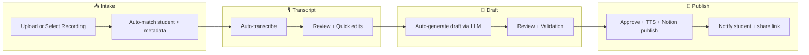

# ESL Pipeline – Frontend Vision v2

> **Purpose:** Define the next-level, end-goal frontend experience for tutors that feels
> effortless, trustworthy, and scalable. This document extends `docs/design/FRONTEND_VISION.md`
> with clearer prioritization, upgraded UX, and backend dependencies.
>
> **Status:** Vision (end-goal). For current implementation status, see
> `docs/frontend-vision-alignment.md` and `docs/backend-frontend/backend-frontend-alignment.md`.

Last updated: 2025-03-10

---

## 1. North Star Experience

**One‑line promise:** A tutor can turn a raw lesson recording into a polished, student‑ready
homework assignment in minutes with total confidence in quality and delivery.

**What “next level” feels like:**

- You can start from any entry point (upload, job, student, or transcript) and never lose context.
- The system tells you what’s ready, what needs attention, and what’s safe to skip.
- Errors are recoverable, and nothing important gets lost (notification log + audit trail).

---

## 2. Vision Pillars

1. **Guided flow, minimal friction**
   - The wizard should feel like a checklist you can trust.
   - Smart defaults eliminate 80% of decisions.

2. **Trust and transparency**
   - Real‑time updates with clear “what happened / what’s next.”
   - Every action has a visible outcome (toast, log entry, status change).

3. **Quality by design**
   - Draft validation, structured warnings, and “jump to line” affordances.
   - Controlled editing with preview parity.

4. **Scale without chaos**
   - Batch‑friendly views, strong search, and predictable organization.
   - Student‑centric navigation for tutors with many learners.

5. **Resilience by default**
   - Offline‑friendly behavior, retriable operations, and graceful degradation.
   - Clear recovery paths when backends are slow or unavailable.

---

## 3. End‑to‑End Journey (v2)

**Happy path:**

1. Open dashboard → see “Ready to review” items.
2. Select a recording (or upload new).
3. Review transcript; quick edits if needed.
4. Generate draft (LLM) or skip to manual draft.
5. Review + validate draft.
6. Publish; receive Notion link + confirmation.

---

## 4. Core Views (v2)

### 4.1 Dashboard (Command Center)

**Goal:** One screen to start work, resolve issues, and confirm outcomes.

**Key sections:**

- **Action Dock:** New assignment, Review drafts, Recover failed jobs.
- **Activity Stream:** Real-time events with quick filters (success/failure/needs action).
- **Pending Approvals:** Drafts ready for review, sorted by urgency.
- **Alerts + Status:** Connection health, errors, queued work count.
- **Weekly Summary:** Workload and usage trends.

**Next-level additions:**

- Global search (students, jobs, recordings).
- Inline “Resume flow” buttons for in‑progress items.
- “Last 24 hours” summary in a single glance.

### 4.2 Wizard (Guided Flow)

**Goal:** A reliable, frictionless workflow with context preserved across steps.

**Phases:**

1. **Select Student + Recording**
2. **Transcript Review**
3. **Notes + Prompt Settings**
4. **Draft Review (Editor + Validation)**
5. **Publish (TTS + Notion + Storage)**
6. **Completion Panel**

**v2 enhancements:**

- **Step header** shows “what’s done / what’s pending.”
- **Auto‑retry transcript** with clear “processing vs missing.”
- **Wizard summary sidebar** (student, recording, prompt, draft status).
- **Completion panel** with Notion link + quick actions.
- **Guided “What’s next?” microcopy** per step.

### 4.3 Job Monitoring (Ops View)

**Goal:** Diagnose, recover, and scale batch work confidently.

**v2 additions:**

- Pipeline stage visualization (validate → extract → notion → tts → upload → attach).
- Queue position + ETA (when backend exposes it).
- One‑click retry/cancel for supported actions.
- Expandable error details with recommended fix.

### 4.4 Student Hub

**Goal:** Organize work by student, not by file or job.

**v2 additions:**

- Dedicated student profile view (goals, focus, history, vocab log).
- Student‑level status banners (pending review, last lesson, next due).
- Student “homework history” timeline with filters.

### 4.5 Settings & Integrations

**Goal:** Default settings are always respected; integrations are visible and stable.

**v2 additions:**

- Integration health checks (Notion, ElevenLabs, Deepgram, S3).
- Notification preferences (toast log, browser notifications, email).
- Preset management shortcuts and import/export.

### 4.6 Notification Center

**Goal:** You never lose important feedback.

**v2 additions:**

- Global notification center (persistent history).
- Filters (errors, warnings, successes).
- Click‑through to relevant entity (job, student, recording).

---

## 5. Smart Automation (High‑ROI)

These upgrades drastically reduce time‑to‑publish without sacrificing control.

- **Auto‑match student + metadata** from filename or historical patterns.
- **Auto‑suggest prompt template** based on student level and recent topics.
- **Auto‑draft preview** if LLM generation is enabled.
- **Auto‑publish option** for trusted students (configurable).

---

## 6. Reliability & Recovery

**Requirements:**

- “Processing” vs “Missing” transcript states must be distinct.
- Clear retry paths for transcript, draft save, publish.
- If SSE fails, fallback to polling and show status banner.
- All user‑facing errors are logged to notification history.

---

## 7. Accessibility & Responsiveness

- Full keyboard navigation in wizard and editor.
- Visible focus states and meaningful ARIA labels.
- Core workflow must be usable on tablet (primary) and mobile (secondary).

---

## 8. Success Metrics (North Star)

- **Median time to publish:** < 5 minutes from upload.
- **Draft correction rate:** < 10% major edits required after LLM generation.
- **Error recovery time:** < 2 minutes to resolve a failure.
- **Tutor confidence score:** > 4.5/5 in usability surveys.

---

## 9. Dependencies & Back‑End Needs

**Required for full v2 delivery:**

- LLM draft generation endpoint(s).
- Transcript status that distinguishes processing vs missing.
- Job stage progress + ETA metadata.
- Student notification delivery (email/SMS/Notion link).
- Usage/cost signals for TTS estimation.

---

## 10. Phased Delivery (Recommended)

**Phase A – High‑ROI UX polish**

- Completion panel after publish.
- Transcript processing indicator with capped retries.
- Wizard summary sidebar + microcopy tips.
- Persistent notification center (history + filters).

**Phase B – Power‑user workflows**

- Job stage visualization + ETA.
- Student hub deep profiles + homework history.
- Global search and quick actions.

**Phase C – Automation**

- LLM draft generation + regeneration controls.
- Auto‑publish and notification delivery.

---

## 11. Relationship to Existing Vision

- `docs/design/FRONTEND_VISION.md` remains the baseline “end‑goal” layout.
- v2 refines it with prioritization, operational reliability, and tutor‑centric scalability.
- Use `docs/frontend-vision-alignment.md` to track implementation coverage.
