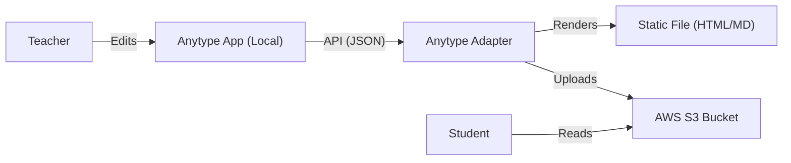

# Anytype Adapter Knowledge Base

This document serves as a comprehensive guide for building the `anytype-adapter` package, designed to work alongside the existing `notion-adapter` in the ESL Pipeline. It consolidates API documentation, authentication details, and architectural recommendations.

## 1. Introduction

The `anytype-adapter` will provide a centralized interface for interacting with the Anytype application (a local-first Notion alternative). It aims to mirror the structure of `@esl-pipeline/notion-adapter` to ensure consistency across the pipeline.

**Target Package:** `@esl-pipeline/anytype-adapter` (New)
**Reference Package:** `@esl-pipeline/notion-adapter`

## 2. Prerequisites & Environment

Unlike Notion, Anytype is a local-first application. The API is hosted locally by the Desktop application.

*   **Anytype Desktop App**: Must be running.
*   **API Host**: Typically `http://localhost:31009`.
*   **Auth**: Bearer Token (API Key).

### Environment Variables
Recommend adding the following to `.env`:

```env
ANYTYPE_API_URL="http://localhost:31009/v1"
ANYTYPE_TOKEN="YOUR_GENERATED_KEY"
ANYTYPE_API_VERSION="2025-11-08"
```

## 3. Authentication

### Generating an API Key
1.  Open **Anytype Desktop App**.
2.  Go to **Settings** -> **API Keys**.
3.  Click **Create new**.
4.  Copy the generated key.

### Authentication Header
All requests must include:
*   `Authorization: Bearer <ANYTYPE_TOKEN>`
*   `Anytype-Version: <ANYTYPE_API_VERSION>`

## 4. Architecture & Interface

To maintain parity with `notion-adapter`, the `anytype-adapter` should expose a similar client factory.

### Client Interface Specification
```typescript
import { ConfigurationError } from '@esl-pipeline/contracts';

// Minimal interface for the Anytype Client
export class AnytypeClient {
  private customBaseUrl: string;
  private token: string;
  private version: string;

  constructor(options: { baseUrl?: string; auth: string; version?: string }) {
    this.customBaseUrl = options.baseUrl || 'http://localhost:31009/v1';
    this.token = options.auth;
    this.version = options.version || '2025-11-08';
  }

  private async request(endpoint: string, method: string, body?: any) {
    const response = await fetch(`${this.customBaseUrl}${endpoint}`, {
      method,
      headers: {
        'Content-Type': 'application/json',
        'Authorization': `Bearer ${this.token}`,
        'Anytype-Version': this.version,
      },
      body: body ? JSON.stringify(body) : undefined,
    });

    if (!response.ok) {
        throw new Error(`Anytype API Error: ${response.status} ${response.statusText}`);
    }
    return response.json();
  }

  // Public Methods
  public async listSpaces() {
    return this.request('/spaces', 'GET');
  }

  public async createObject(spaceId: string, data: any) {
    return this.request(`/spaces/${spaceId}/objects`, 'POST', data);
  }
  
  public async getObject(spaceId: string, objectId: string) {
    return this.request(`/spaces/${spaceId}/objects/${objectId}`, 'GET');
  }

  public async globalSearch(query: string, limit: number = 10) {
      return this.request('/search', 'POST', { query, limit });
  }
}

export function createAnytypeClient(): AnytypeClient {
  const token = process.env.ANYTYPE_TOKEN;
  if (!token) throw new ConfigurationError('ANYTYPE_TOKEN is required in environment');
  
  const baseUrl = process.env.ANYTYPE_API_URL; // Optional, defaults to localhost if missing
  
  return new AnytypeClient({ auth: token, baseUrl });
}
```

## 5. API Reference & Snippets

### Base URL
`http://localhost:31009/v1`

### 5.1. List Spaces
You need a `space_id` to create objects.

**Endpoint:** `GET /spaces`

**Response:**
```json
[
  {
    "id": "bafy...",
    "name": "My Personal Space"
  }
]
```

### 5.2. Create Object (Page)
Anytype supports Markdown in the `body` field, which simplifies the `mdToBlocks` conversion logic compared to Notion.

**Endpoint:** `POST /spaces/{space_id}/objects`

**Payload:**
```json
{
  "name": "New Lesson Page",
  "type_key": "page",
  "icon": { "emoji": "📖", "format": "emoji" },
  "body": "## Lesson Title\n\nContent goes here...",
  "properties": [
    { "key": "status", "select": "Draft" },
    { "key": "student", "text": "Student Name" }
  ]
}
```

### 5.3. Search / Query
Useful for finding the "Student Page" or "Database".

**Endpoint:** `POST /spaces/{space_id}/search`

**Payload:**
```json
{
  "query": "Student Name",
  "types": ["page", "object"],
  "sort": { "field": "timestamp", "direction": "desc" }
}
```

### 5.4. Update Object
**Endpoint:** `PATCH /spaces/{space_id}/objects/{object_id}`

**Payload:** (Partial Update)
```json
{
  "body": "## Updated Content\n\nNew text...",
  "properties": [
      { "key": "status", "select": "Published" }
  ]
}
```

## 6. Implementation Checklist

1.  [ ] **Initialize Package**: Create `packages/anytype-adapter`.
2.  [ ] **Dependencies**: Install `cross-fetch` or use Node 18+ native `fetch`.
3.  [ ] **Types**: Define interfaces for `AnytypeObject`, `AnytypeBlock`, `AnytypeSpace` in `types.ts`.
4.  [ ] **Client**: Implement `AnytypeClient` class (as sketched above).
5.  [ ] **Tests**: Since Anytype is local, unit tests might need to mock `fetch`, or integration tests will require the app to be running.
6.  [ ] **Contracts**: Ensure it throws `ConfigurationError` from `@esl-pipeline/contracts` on missing config.

## 7. Comparison with Notion Adapter

| Feature | Notion Adapter | Anytype Adapter |
| :--- | :--- | :--- |
| **Auth** | OAuth / Secret Token | Local API Key (Bearer) |
| **Content** | Block-based (Complex JSON) | Markdown-based (Simple String) |
| **Connectivity**| Cloud API (HTTPS) | Localhost API (HTTP) |
| **Latency** | Medium | Very Low (Local) |
| **Tables/DBs** | First-class "Databases" | "Sets" or "Collections" (Query-based) |

## 8. Useful Resources

*   **Official Docs**: `https://github.com/anyproto/anytype-api`
*   **MCP Server**: `@anyproto/anytype-mcp` (can be used for CLI testing)

## 9. Sharing & Asset Management (Architecture Strategy)

**Strategy: The Split Architecture**

We separate "Private Storage" from "Public Publishing".

### 9.1. The "Split" Concept
1.  **Private Storage (Source of Truth)**:
    *   **Where**: Anytype (Local + optional Sync Node).
    *   **Data**: Encrypted, editable, authoritative source.
    *   **Role**: This is your "Database". You edit here. The pipeline *reads* from here.

2.  **Public Publishing (Distribution)**:
    *   **Where**: Project S3 Bucket.
    *   **Data**: Static, unencrypted (public-read) snapshots (HTML/PDF/Markdown).
    *   **Role**: This is your "Web Server". Students view this. The pipeline *writes* to here.

### 9.2. Why this is better?
*   **Security**: You never accidentally expose your entire database. You only publish exactly what you export.
*   **Simplicity**: You don't need to struggle with decrypting Anytype's backing store. You use the API to get clean data.
*   **Cost**: You avoid paying for Anytype's cloud storage usage (since you self-host or keep it local) and only pay pennies for S3 static files.

### 9.3. Workflow Diagram


### 9.4. Implementation Snippet (Export & Upload)
Reuse the existing `uploadToS3` utility from `@esl-pipeline/storage-uploader`.


```typescript
import { createAnytypeClient } from './client.js';
import { uploadToS3 } from '@esl-pipeline/storage-uploader';

export async function sharePageToS3(spaceId: string, pageId: string) {
  const client = createAnytypeClient();
  
  // 1. Fetch Page
  const page = await client.getObject(spaceId, pageId);
  
  // 2. Prepare Content (Example: Save as Markdown)
  // In a real app, you might convert this to PDF or HTML
  const content = `# ${page.name}\n\n${page.body}`;
  const filename = `${pageId}.md`; // or .html, .pdf using a renderer
  
  // 3. Upload to S3
  // Uses existing project infra. Ensure AWS creds are set.
  const uploadResult = await uploadToS3('/tmp/' + filename, {
    bucket: process.env.S3_BUCKET,
    keyPrefix: 'materials/anytype-exports', // Organize within bucket
    publicRead: true, // If bucket allows ACLs
  });
  
  return uploadResult.url; 
}
```

### 9.4. Serving Static Assets
For images or files *embedded* in an Anytype page:
*   The Anytype API response for a Block/Object will contain references to files.
*   The Adapter must download these assets (via API), then re-upload them to S3.
*   The Adapter must then rewrite the links in the exported Markdown/HTML to point to the new S3 URLs.

## 10. Static Rendering Strategy (The "Voila" Experience)

To meet the requirement of "no dependencies, any device" for students, the adapter should generate **standalone HTML files**.

### 10.1. Technology Stack (Lightweight)
*   **Renderer**: `markdown-it` (Fast, simple, extensible).
*   **Styling**: `github-markdown-css` (Inline CSS for instant, familiar look).
*   **Audio**: Native HTML5 `<audio>` tags.

### 10.2. The "Single File" Concept
Instead of a folder with `style.css` and `script.js`, we inline everything into `homework.html`.
*   **CSS**: Read `node_modules/github-markdown-css/github-markdown.css` and inject into `<style>`.
*   **Audio**: Transform interactions to simple `<audio controls src="...">`.

### 10.3. Proposed Render Function
```typescript
import MarkdownIt from 'markdown-it';
import { readFile } from 'node:fs/promises';

export async function renderToHtml(markdown: string, title: string): Promise<string> {
  const md = new MarkdownIt({
    html: true,
    linkify: true,
  });

  // Custom generic plugin for audio players if needed, 
  // or just trust the user to write <audio> tags or standard links.
  // For standard links [Audio](url.mp3), we could use a custom render rule to turn them into players.

  const bodyHtml = md.render(markdown);
  // Optional: Fetch standard CSS
  // const css = await readFile('./node_modules/github-markdown-css/github-markdown.css', 'utf-8');
  const css = "body { max-width: 800px; margin: 0 auto; padding: 20px; font-family: system-ui; }"; // Simplified

  return `<!DOCTYPE html>
<html lang="en">
<head>
    <meta charset="UTF-8">
    <meta name="viewport" content="width=device-width, initial-scale=1.0">
    <title>${title}</title>
    <style>
      ${css}
      /* Custom Audio Player Styling */
      audio { width: 100%; margin: 10px 0; }
    </style>
</head>
<body class="markdown-body">
    <h1>${title}</h1>
    ${bodyHtml}
</body>
</html>`;
}
```

### 10.4. Audio Links
If the markdown contains `[Listen to audio](https://s3.../file.mp3)`, the student clicks and it opens.
To make it an *embedded player*, we can extend `markdown-it`:

```typescript
// Detect links ending in .mp3 and render as <audio>
const defaultRender = md.renderer.rules.link_open || function(tokens, idx, options, env, self) {
  return self.renderToken(tokens, idx, options);
};

md.renderer.rules.link_open = function (tokens, idx, options, env, self) {
  const href = tokens[idx].attrGet('href');
  if (href?.endsWith('.mp3')) {
    return `<audio controls src="${href}"></audio><a href="${href}" style="display:none">`; // Hacky but works to hide the original text or replace it
  }
  return defaultRender(tokens, idx, options, env, self);
};
```

### 10.5. Advanced Interactive Elements (Toggles)

To achieve the "Notion-like" toggle functionality in a static file, we use the standard HTML `<details>` and `<summary>` tags.

**Anytype Source (Markdown):**
Anytype likely exports toggles as nested lists or standard headers, but if we want explicit toggles, we can use a "Container" syntax in our assignments (which acts as a convention) or detect specific patterns.

**Recommended Convention:**
Use the `markdown-it-container` plugin to support "Toggle" blocks using `:::` syntax.

**Input (Anytype):**
```markdown
::: toggle Click to see answer
The answer is 42.
:::
```

**Implementation:**
```typescript
import container from 'markdown-it-container';

md.use(container, 'toggle', {
  validate: function(params) {
    return params.trim().match(/^toggle\s+(.*)$/);
  },
  render: function (tokens, idx) {
    var m = tokens[idx].info.trim().match(/^toggle\s+(.*)$/);

    if (tokens[idx].nesting === 1) {
      // opening tag
      return '<details><summary>' + md.utils.escapeHtml(m[1]) + '</summary>\\n';
    } else {
      // closing tag
      return '</details>\\n';
    }
  }
});
```

**Result (Static HTML):**
Renders as a native interactive widget.
*   **Closed**: `▶ Click to see answer`
*   **Open**: 
    ```
    ▼ Click to see answer
      The answer is 42.
    ```
    ```
    ▼ Click to see answer
      The answer is 42.
    ```

### 10.6. Feature Parity (All Notion Features)

To match the existing `notion-adapter` capabilities (Callouts, Columns, Video, TOC), we mapping specific directives to HTML.

#### A. Callouts (`:::callout 💡`)
*   **Render**: `<aside class="callout"><div class="icon">💡</div><div class="content">...</div></aside>`
*   **CSS**:
    ```css
    .callout { background: #f0f0f0; padding: 16px; border-radius: 4px; display: flex; gap: 12px; }
    .icon { font-size: 24px; }
    ```

#### B. Columns (`:::column-list`)
*   **Render**: `<div class="column-list"><div class="column">...</div></div>`
*   **CSS**:
    ```css
    .column-list { display: flex; gap: 20px; flex-wrap: wrap; }
    .column { flex: 1; min-width: 250px; } /* Responsive wrapping */
    ```

#### C. Video Embeds (`:::video URL`)
*   **Render**: Convert YouTube/Vimeo URLs to IFrames.
    ```html
    <div class="video-embed">
      <iframe src="https://www.youtube.com/embed/..." allowfullscreen></iframe>
    </div>
    ```

#### D. Table of Contents (`:::toc`)
*   **Implementation**: Use `markdown-it-anchor` + `markdown-it-toc-done-right`.
*   **CSS**:
    ```css
    .table-of-contents { background: #fafafa; padding: 1rem; border-radius: 8px; }
    .table-of-contents ul { list-style: none; padding-left: 0; }
    ```

#### E. Synced Blocks
*   **Strategy**: Since there is no "sync" in a static HTML file, simply render the *content* of the block directly. The "sync" aspect is a storage-layer concern (managed in Anytype), but the *output* is just the text.

### 10.7. Full "Renderer" Factory
The final adapter should export a robust renderer:

```typescript
export async function createStaticPageHtml(markdown: string, title: string) {
    // 1. Configure markdown-it with all plugins (container, toc, anchor)
    // 2. Inject the "Universal CSS" (Github style + Custom Feature CSS)
    // 3. Process the markdown
    // 4. Return complete <!DOCTYPE html> string
}
```

### 10.8. Rich Formatting & Colors

### 10.8. Formatting, Colors & Theming

We handle formatting in three layers:

#### A. Global Theming (Auto-Coloring)
Instead of expensive API calls to colorize headers blocks, we use **CSS Variables** in the static HTML.
*   **Config**: Read `configs/presets.json`.
*   **Output**:
    ```css
    :root {
      --theme-h1: #37352f;
      --theme-h2: #d9730d; /* Amber */
      --theme-h3: #6940a5; /* Purple */
    }
    h2 { color: var(--theme-h2); }
    h3 { color: var(--theme-h3); }
    ```

#### B. Native Colors (User Edits)
When you manually color text in Anytype:
*   The Adapter detects native color attributes (HTML spans or Block JSON) during export.
*   These are rendered faithfully to HTML. **No custom syntax required.**

#### C. Generator Directives (LLM Only)
For the LLM to request specific colors during draft generation:
*   **Syntax**: `:::color blue` or `<span class="blue">`.
*   **Note**: This is only for the *generation* phase. Users should use the Anytype UI.

## 11. End-to-End Workflow (User Journey)

**Goal**: Seamless replacement of Notion with Anytype while keeping the "Upload -> Publish -> Share" pipeline.

### The Phases

1.  **Drafting (Pipeline -> Anytype)**
    *   **Input**: Audio File + Transcript.
    *   **Action**: LLM generates the Markdown Draft (with `:::toggle`, `:::callout`, etc.).
    *   **System**: Adapter uses `createObject` API to push this Draft into your local Anytype Space.
    *   **User Exp**: You open Anytype and see the new page ready for review.

2.  **Refinement (User in Anytype)**
    *   **Action**: You fix typos, add notes, or change colors (using `:::color` or spans).
    *   **System**: You are editing the "Source of Truth" in Anytype.

3.  **Publishing (Anytype -> S3)**
    *   **Action**: You run the "Publish" command (or click a button in your dashboard).
    *   **System**:
        1.  Adapter fetches the Page from Anytype API.
        2.  Adapter **Renders** it to a single `homework.html` file (resolving all toggles, colors, audio).
        3.  Adapter **Uploads** `homework.html` to S3.
        4.  Adapter returns the verifyable, shareable S3 link.
    *   **Result**: Student gets a fast, mobile-friendly, interactive HTML page. No dependency on Notion or Anytype cloud.
