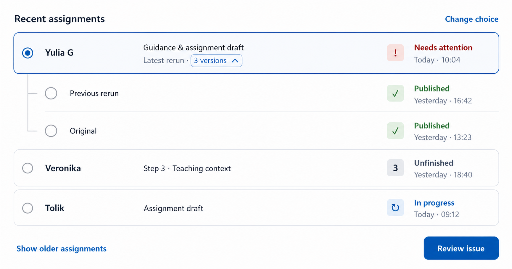

# Assignment Resume List Design

## Meta

- Date: 2026-07-16
- Status: review requested
- Scope: the Step 1 `Resume recent work` list, rerun presentation, and progressive access to older
  assignments
- Contract boundary: frontend presentation and loading behavior over existing assignment-session and
  job contracts; no backend, DTO, database, or persistence-contract change
- Supersedes: the resume-list presentation and the pagination non-goal in
  `2026-07-13-assignment-step-one-entry-state-design.md`; all other entry-state rules remain current

## Summary

The resume route is a short-horizon recovery surface, not a general assignment archive. Tutors use it
primarily to continue unfinished work from the last day, correct and republish a recently shared
assignment, or occasionally reopen lesson guidance and an assignment draft as reference.

The current list renders every job or session as a tall peer row. It grows until the loaded items run
out, repeats status information, and lets reruns crowd out unrelated assignments even though a rerun
is another version of the same assignment.

The redesigned list shows four recent assignment lineages by default. Each row has three stable
information regions: learner identity on the left, a contract-backed recovery anchor in the center,
and a fixed status-and-time rail on the right. Reruns collapse into version history under their latest
job. Older assignment lineages load progressively in small batches without a nested scroll region,
modal, search interface, or archive subsystem.

## Approved Visual Reference

The image fixes the desktop hierarchy, expanded rerun treatment, state rail, version-count disclosure
pill, and removal of decorative history nodes. The behavioral and accessibility rules below remain
authoritative where a static image cannot express hover, focus, loading, responsive, or error states.

## Goals

1. Keep the normal 0-2 day resume choice short and scannable.
2. Make assignment state obvious without turning rows into status-heavy dashboard cards.
3. Show where unfinished work was saved and which useful material a job can recover.
4. Treat reruns as versions of one assignment instead of unrelated duplicate rows.
5. Preserve exact access to original and rerun jobs when their lineage is available.
6. Allow deliberate access to older work without ever rendering an unbounded list at once.
7. Use existing frontend contracts and loaded option maps only.

## Information Model

### Row regions

Desktop rows use four grid columns:

1. native radio selection
2. learner name
3. recovery anchor and optional rerun disclosure
4. fixed-width state rail

The learner column contains only the learner name. Generic explanations such as `Existing work is
preserved`, `Latest progress will be shown`, and other status paraphrases do not appear in the row.

The center and right regions have distinct jobs:

- center: what useful material exists or where unfinished work resumes
- right: current state and last-activity time

The center must never repeat the state label using phrases such as `Generation underway` beside `In
progress` or `Review the issue` beside `Needs attention`.

### Recovery anchors

Saved sessions use `currentStage` to show the exact workflow location:

| Session stage | Center anchor               |
| ------------- | --------------------------- |
| `source`      | `Step 2 · Lesson source`    |
| `context`     | `Step 3 · Teaching context` |
| `assignment`  | `Step 4 · Create`           |
| `review`      | `Step 5 · Review & share`   |

Job-backed items derive a recovery anchor only from artifact IDs already present on `JobStatusDto`:

| Available contract evidence                         | Center anchor                 |
| --------------------------------------------------- | ----------------------------- |
| `promptPackageId` and `draftId`                     | `Guidance & assignment draft` |
| `draftId` only                                      | `Assignment draft`            |
| `promptPackageId` only                              | `Lesson guidance`             |
| `transcriptId` or `recordingId`, with neither above | `Lesson source`               |
| None of the above                                   | no anchor text                |

Raw lesson, recording, transcript, prompt-package, draft, session, and job IDs never appear in the
primary row.

`RecentAssignmentItem.lessonTitle` remains optional, but the current resume collections do not
populate it. This slice does not add schedule lookups, per-row requests, markdown parsing, memory
queries, or a DTO change to synthesize lesson titles. Showing a lesson title is a future enhancement
that requires real contract evidence and separate review.

## State Rail

The right rail has one fixed desktop width and an internal fixed icon column. Icon, label, and
timestamp start positions do not shift with label length. This prevents the uneven indentation seen
when every state block is merely right-justified to its content width.

State uses a restrained icon and semantic color only inside the state rail. Row backgrounds remain
neutral apart from selection.

| State              | Icon treatment                                        | Label             |
| ------------------ | ----------------------------------------------------- | ----------------- |
| unfinished session | saved step number in a neutral slate square           | `Unfinished`      |
| queued or running  | circular progress mark in a restrained blue square    | `In progress`     |
| ready for review   | document/check treatment in a restrained success tint | `Ready to share`  |
| published          | checkmark in a restrained green square                | `Published`       |
| failed             | exclamation mark in a restrained red square           | `Needs attention` |

The visible label always accompanies the icon, so state never depends on color or icon recognition
alone. Icons use the existing icon/component vocabulary where possible; this design does not add an
icon dependency.

Selection stays visually independent from state:

- the native radio identifies the chosen job or session
- a primary-color border and quiet neutral tint reinforce the selected row
- semantic state color does not spread across the row or become a selection signal

## Rerun Lineages

### Grouping rule

`JobStatusDto.sourceJobId` is the only valid evidence that two jobs belong to one rerun lineage.
Build connected lineages by following parent links among loaded jobs, including rerun-of-rerun
chains.

Never infer a lineage from matching learner, lesson ID, artifact IDs, timestamps, labels, or other
similar fields. Separate assignments for the same learner must remain separate.

When a rerun references a source job that is not loaded, render it as a standalone assignment row
and identify it quietly as `Rerun`. Do not label the earliest loaded node `Original` unless its own
`sourceJobId` is empty. If later progressive loading supplies the parent, regroup the lineage while
preserving selection by exact job ID.

### Collapsed lineage

One assignment lineage consumes one visible assignment slot. Its main row represents the latest
loaded version and uses the normal learner, recovery-anchor, and state-rail design.

When the lineage has multiple versions, the center contains a second quiet line. `Latest rerun`
remains plain supporting text beside a compact outlined disclosure pill containing `N versions` and
an up/down chevron.

The pill must read as interactive without becoming a competing primary action:

- default: quiet neutral or primary-tinted border and surface
- hover: stronger border, slightly stronger tint, and primary-color text
- focus-visible: the established keyboard focus ring with sufficient offset
- active: brief pressed-state tint without scale or bounce
- expanded: upward chevron and `aria-expanded="true"`
- collapsed: downward chevron and `aria-expanded="false"`

The disclosure does not replace the row radio, and activating it does not select or open a job.

### Expanded lineage

Expanding version history keeps the latest version in the full main row. Earlier versions appear on
a slim indented history thread beneath it rather than inside a nested card. The thread uses only a
quiet vertical rule and short horizontal connectors. It does not add decorative node circles; the
native version radio is the only circle on each earlier-version row.

Each earlier version shows only:

- its own native radio
- `Previous rerun`, or `Original` when proven by an empty `sourceJobId`
- the same icon, state label, and timestamp rail used by normal rows

Learner name and recovery anchor are supplied by the lineage and are not repeated for every version.
Every version remains separately selectable and opens its exact job. The route primary action always
matches the selected version's current state.

## Recent and Older Assignment Behavior

### Initial view

Show the four newest assignment lineages after sessions and job lineages are combined and sorted by
their latest activity. A standalone session is one lineage. A rerun family is one lineage regardless
of its loaded version count.

The control below the initial list reads `Show older assignments` when additional lineages may be
available.

### Progressive disclosure

The first activation appends up to eight more assignment lineages below the existing four. The
control then reads `Load more` while either source may contain additional items. Each later activation
appends another small lineage batch.

The UI does not promise a numeric batch size or display `X of Y`. Existing source totals count raw
jobs and sessions, while the visible UI counts collapsed lineages; presenting those totals as
assignment counts would be misleading.

Progressive loading follows these rules:

1. Never replace or hide already visible rows while loading another batch.
2. Show loading feedback at the bottom near `Load more`.
3. Show a bottom-local `Try again` on failure and retain the previously loaded lineages.
4. Remove the control when both job and session sources are exhausted.
5. Do not introduce an inner scroll container. Page height grows only after an explicit load action.
6. Do not add a collapse action. Step 1 is a short transaction, and removing loaded rows creates
   avoidable hidden-selection behavior.
7. Preserve selection by exact session or job ID when new data changes sorting or lineage grouping.
8. If a selected older job becomes a child of a newly completed lineage, keep that lineage expanded
   so the selected radio remains visible.

The implementation may use the existing job `limit`/`offset` contract and the assignment-session
`limit`/`total` contract. It must merge, deduplicate, rebuild proven lineages, and sort client-side.
No unified history endpoint is introduced in this slice.

If later practical use shows frequent deep retrieval across dozens of batches, that is evidence for
a dedicated Assignment history surface with learner/date discovery. Step 1 must not grow those
archive responsibilities preemptively.

## Layout and Responsive Behavior

- Desktop keeps learner, recovery anchor, and state rail on one row.
- The center receives the flexible width; learner and state regions remain stable.
- Long learner and anchor text truncate visually but remain available to assistive technology and
  through the row's accessible name.
- At narrow widths, learner and state remain on the first line and the recovery anchor moves below
  them. The state rail retains aligned icon, label, and time columns.
- Expanded version rows follow the same responsive state-rail behavior.
- Controls retain at least a 44px interactive target even when the visible icon or text is smaller.

## Loading, Error, and Empty States

- Initial recent-work loading continues to replace the route content with the existing stable loading
  state.
- Progressive loading affects only the bottom control region.
- A progressive-load error does not convert the entire resume route to an error screen.
- If the initial collections contain no resumable items, retain the existing Step 1 behavior that
  returns to the choice state and disables Resume.
- If later loading adds no new visible lineage because all fetched jobs belong to already loaded
  rerun families, continue according to source exhaustion rather than rendering duplicate rows.

## Accessibility Contract

- The list remains a labelled fieldset with native radio inputs.
- Selecting a row and expanding version history are separate keyboard-operable actions.
- Version disclosures expose `aria-expanded` and reference their history region with
  `aria-controls`.
- The version-count pill has distinct default, hover, active, and focus-visible states.
- State icons are decorative (`aria-hidden`) because adjacent text supplies the state.
- Loading and errors are announced without moving focus away from the current selection.
- Loading more does not move focus to the appended rows; focus remains on the load control after the
  update.
- A regroup caused by newly loaded parents preserves the selected job and keeps its radio visible.
- Selection, state, version relationship, and loading never rely on color alone.

## Motion

- Version expansion uses a short 150-200ms state transition only when it clarifies the disclosure.
- No staggered row entrances or page-load choreography is added.
- Reduced-motion mode renders expansion without movement.
- Progressive loading does not animate existing rows or reorder them before the new data is ready.

## Test Contract

Focused frontend tests must prove:

1. Four newest lineages render initially even when a lineage contains several jobs.
2. Learner, recovery anchor, and fixed state rail contain the correct non-duplicative information.
3. Every session stage maps to the correct numbered workflow anchor.
4. Job artifact-ID combinations map to the documented recovery anchors without raw IDs.
5. Every assignment state renders the correct icon treatment, label, and timestamp.
6. Status alignment does not depend on label length.
7. Jobs group only through loaded `sourceJobId` relationships, including chained reruns.
8. Similar jobs without a proven parent link remain separate.
9. A rerun with a missing source remains standalone and is not called `Original`.
10. Collapsed lineages show the latest job and correct version count.
11. Expanded history removes repeated learner/artifact fields while retaining exact radio choices.
12. Selecting an original, previous rerun, or latest rerun opens that exact job with the correct
    status-specific action.
13. Progressive disclosure appends lineages without replacing visible content.
14. Rerun versions do not consume progressive-disclosure assignment slots.
15. Load-more failure preserves current rows and selection and exposes a bottom-local retry.
16. Exhausting both sources removes `Load more` without an inaccurate raw-item count.
17. Loading a previously missing source regroups the lineage while preserving and revealing the
    selected job.
18. Desktop and narrow layouts retain keyboard operation, readable hierarchy, and visible state.

## Non-Goals

- Search, learner filters, date filters, sorting controls, or a dedicated history route.
- Numbered pagination or an infinite-scroll observer.
- A nested scroll panel, drawer, popover, or modal for older assignments.
- A backend endpoint, DTO field, database migration, or persisted lineage aggregate.
- Fetching lesson titles from schedules, student memory, recordings, markdown, or per-row requests.
- Guessing lineage from matching assignment fields.
- Comparing or diffing rerun content.
- Naming the rerun operation type when the list contract supplies only `sourceJobId`.
- Redesigning the Step 1 default choice, New route, existing-assignment summary, or Steps 2-5.

## Completion Criteria

1. Step 1 initially shows four compact assignment lineages rather than every loaded raw item.
2. Rows use the approved learner, recovery-anchor, and fixed state-rail hierarchy.
3. State icons and labels remain consistent across normal rows and rerun history.
4. Reruns collapse only through proven `sourceJobId` relationships.
5. Original and rerun jobs remain individually accessible.
6. Older lineages load progressively in small explicit batches without misleading totals or nested
   scrolling.
7. Existing frontend/backend contracts remain unchanged.
8. Focused tests cover mapping, lineage, selection, loading, errors, exhaustion, and responsive
   behavior.
